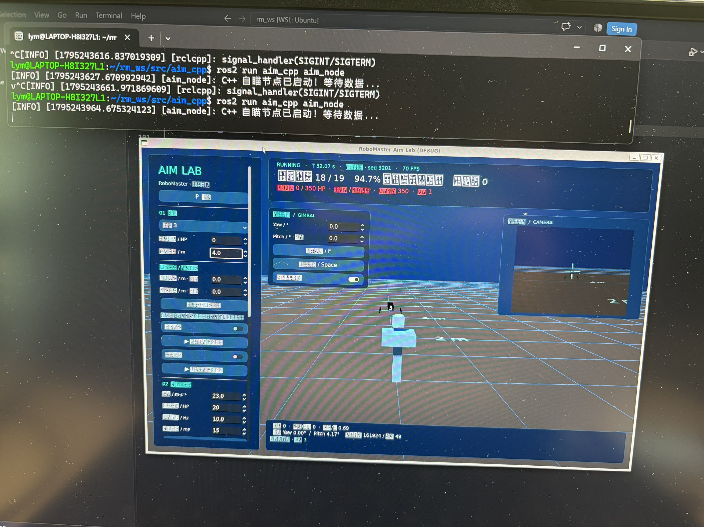
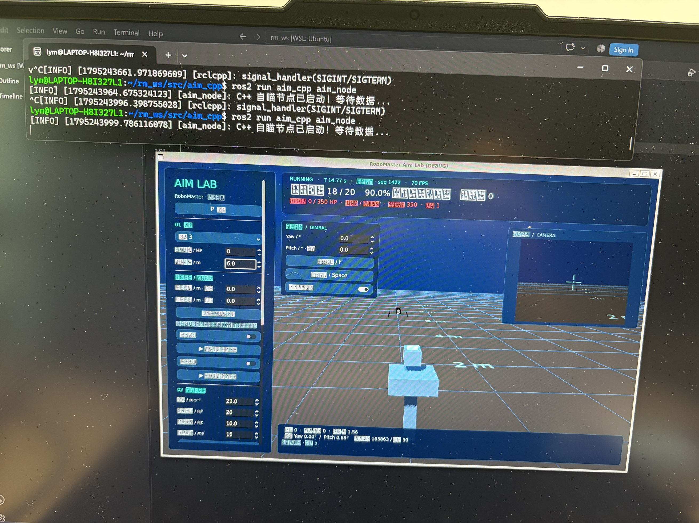
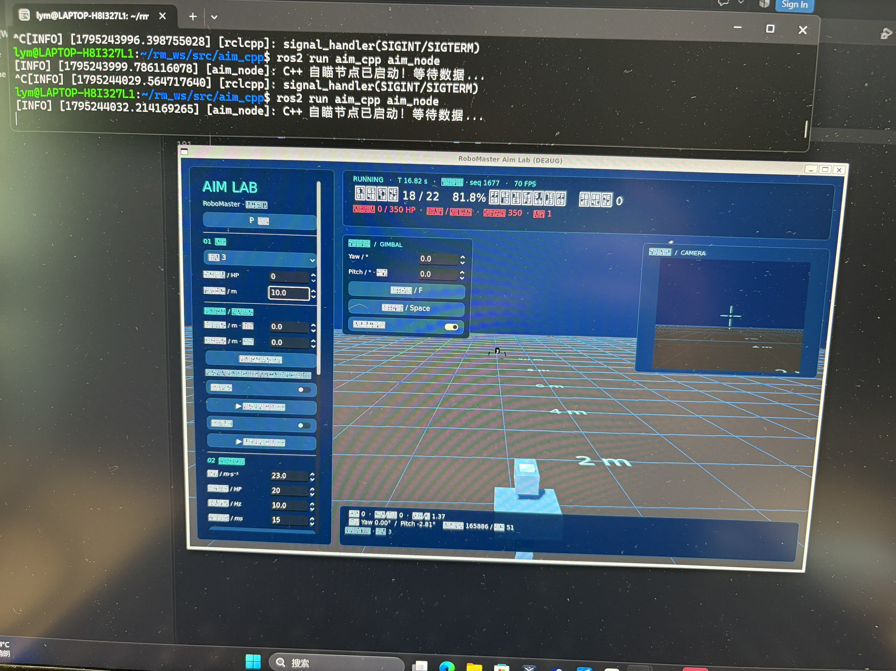
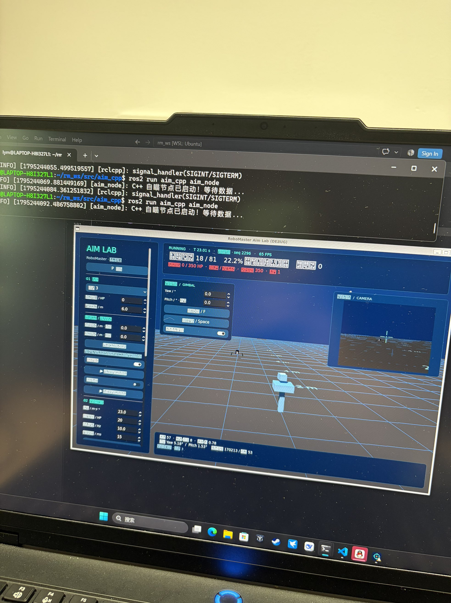
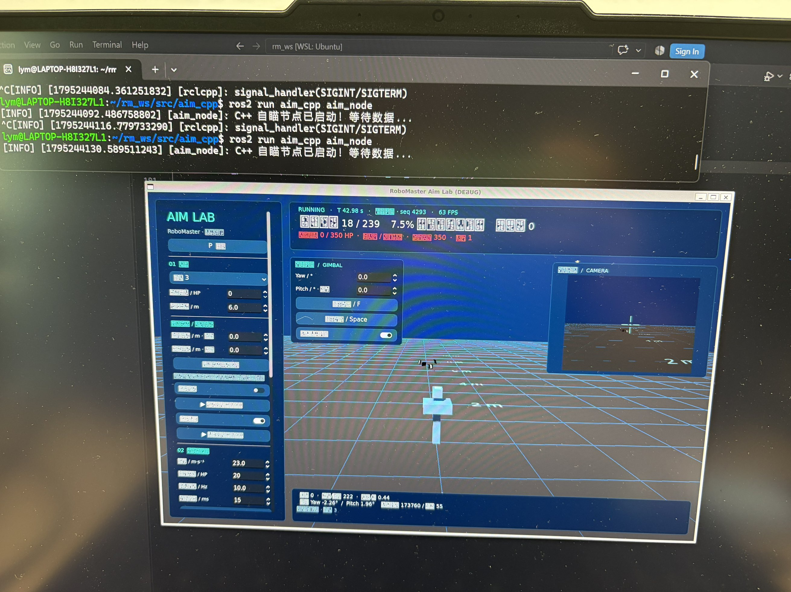
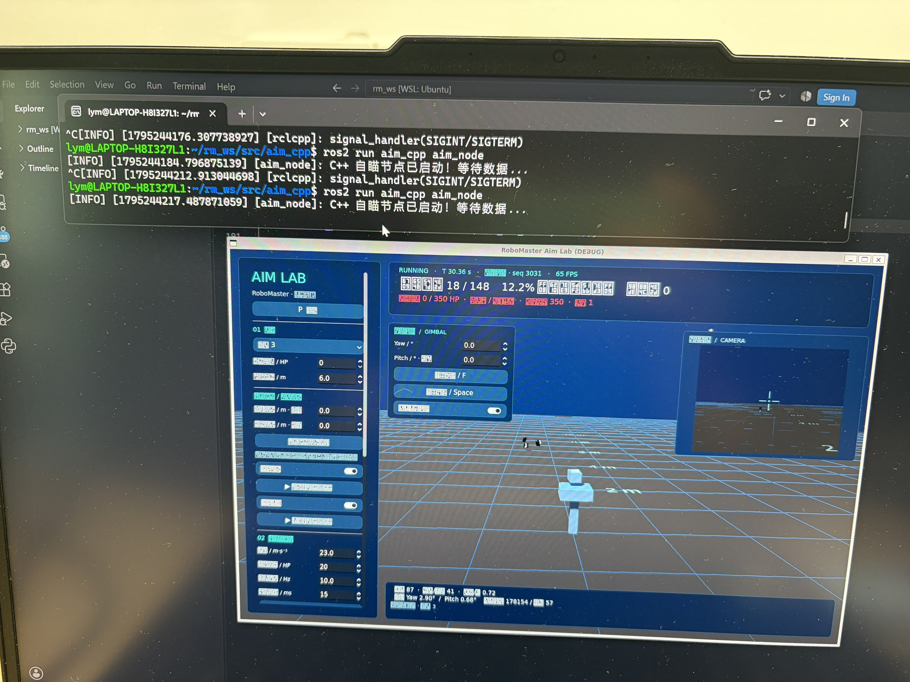

# RoboMaster 视觉自瞄考核项目

## 1. 编译与运行方法
- 编译：`colcon build --packages-select aim_cpp`
- 运行：`ros2 run aim_cpp aim_node`

## 2. 程序结构
- `aim_node.cpp`：核心自瞄节点。
- 订阅话题：`/aim_sim/armors`, `/aim_sim/gimbal`, `/aim_sim/telemetry`
- 发布话题：`/aim_sim/command`

## 3. 核心算法思路
1. **目标锁定**：基于 3D 坐标计算装甲板物理宽度，选择最宽的正面板进行锁定，避免侧板透视欺骗。
2. **弹道解算**：考虑枪管长度（0.22m）带来的三维位置偏移，并加入重力下抛运动补偿。
3. **运动预测**：通过帧间差分计算目标速度，加入一阶低通滤波平滑突变，并结合开火延迟（0.015s）计算提前量。
4. **防抖与异常处理**：加入了速度限幅、反向变向检测，以及针对掉帧环境的 dt 拦截逻辑，保证云台在高帧率波动下稳定运行。

## 4. 考核成绩

